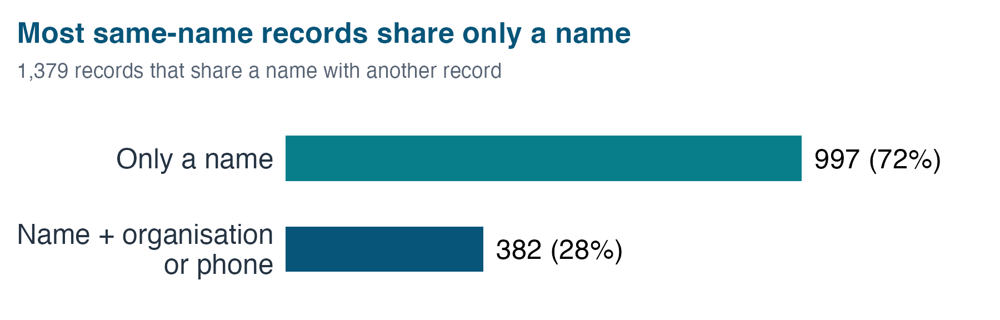

## Science Teachers’ Association of Victoria (STAV) {.cover}

Understanding STAV’s contacts and website use

Feng Zhu ETC5543 · Semester 2, 2026

How can STAV use its existing data to support better decisions?

::: {.notes}
Good morning, everyone. My name is Feng Zhu, and today I'll be presenting my placement project with the Science Teachers' Association of Victoria, also known as STAV.

STAV supports science teachers and students through memberships, conferences, and competitions such as the Science Talent Search.

The main question behind my project was simple: **How can STAV use the data it already has to make better decisions?**

:::

## Business problems and data {.problem-slide}

<b>STAV’s pain points</b><small>• Cannot reliably report by school: the same school appears under many names in the CRM • Unclear what website data means for decisions: which pages to maintain, whether key actions are tracked</small>

<b>What I delivered</b><small>1. A reviewed school-name mapping 2. CRM review priorities 3. Website content and tracking findings 4. A Shiny dashboard</small>

<b>CRM</b>STAV’s member and contact database<strong>6,051 records</strong><small>Snapshot: 29 July 2026</small>

<b>GA4</b>Google Analytics data for the STAV website<strong>55,599 active users</strong><small>1 July 2025 – 30 June 2026</small>

::: {.source}
Both are one-off snapshots; website visitors cannot be matched to individual CRM contacts.
:::

::: {.notes}
STAV had two main business pain points. First, STAV could not get reliable answers from their CRM, for example how many contacts or members each school has. The same school appears under many different names in the CRM, and some records are incomplete or inconsistent, partly because the data was migrated from another platform. Second, they had Google Analytics data, but it was not clear what it meant for decisions about the website, such as which pages to maintain and whether important actions are tracked. I worked with two sources: a CRM snapshot of about six thousand records, and a year of Google Analytics data. Website visitors cannot be matched to CRM contacts, so I analysed the two separately. My role was to audit the CRM data, analyse the website data, and turn both into practical next steps. Today I will cover four things I delivered: a reviewed school-name mapping, CRM review priorities, website findings, and a Shiny dashboard.

Sources: reports/CRM/02_crm_analysis_report.qmd; reports/GA4/stav_website_report.qmd; R/crm_organisation_master_mapping.R.
:::

## CRM and website analysis workflow

DATAPREPARATIONANALYSISOUTPUTS

<b>CRM snapshot</b><small>Contact records</small>

<b>Validate imports</b><small>Standardise fields</small>

<b>Review records</b><small>Contacts &amp; membership</small>

<b>Review priorities</b><small>Records needing checks</small>

School names<b>Fuzzy candidate pairs</b><i>→</i><b>Supervisor review</b><i>→</i><b>250 approved schools</b>

<b>GA4 exports</b><small>Website activity</small>

<b>Group pages</b><small>Business categories</small>

<b>Compare usage</b><small>Check tracking gaps</small>

<b>Website priorities</b><small>Content &amp; measurement</small>

<b>How school names were matched</b>
<ol>
<li>Focus on school names only: <b>544</b> different names across the CRM’s 6,000+ contacts.</li>
<li>Flag two names as a possible match if they are spelled almost the same (e.g. “Collage” vs “College”) or one contains the other.</li>
<li>My supervisor reviewed every flagged pair (78% were correct) → <b>250</b> approved schools.</li>
</ol>

::: {.notes}
I organised the work into two streams. Although the CRM has over six thousand contacts, the matching focused only on school names, and those schools appear under five hundred and forty-four different names. I wrote a matching step that flagged two names as a possible match when they were spelled almost the same, no more than about one letter in five different, such as a small typo, or when one name contained the other. My supervisor at STAV then manually reviewed every flagged pair. About seventy-eight percent were correct, so roughly one in five was wrong. The result is two hundred and fifty approved schools. For GA4, I grouped pages into business categories and compared traffic, content use and tracking gaps.

Sources: reports/CRM/02_crm_analysis_report.qmd; reports/GA4/stav_website_report.qmd; R/crm_organisation_master_mapping.R.
:::

## Fuzzy matching supports school name standardisation {.crm-section .school-example-slide}

{.evidence-plot fig-alt="Reviewed schools by number of CRM names: 90 with one, 98 with two, 28 with three, 24 with four to five, and 10 with six or more."}

<strong>544</strong>distinct CRM school names

<strong>250</strong>approved schools reviewed

<strong>64%</strong>have multiple names (160/250)

<b>Example: Caulfield Grammar School</b> “Caulfield Grammar” + “Caulfield Grammar Malvern Campus” → approved school: <b>Caulfield Grammar School</b><small>9 CRM name variations in the reviewed mapping; campus information remains separate.</small>

Source: CRM report §4.1. Nine ambiguous names still need review.

::: {.notes}
Looking at those two hundred and fifty approved schools, almost two-thirds appear under more than one name in the CRM. Rather than reading every bar, I will use the example below. Caulfield Grammar School has nine name variations, including the shorter name Caulfield Grammar and a name referring to its Malvern campus. The mapping links these to an approved school while keeping campus information separate. STAV can now use this mapping to standardise school names in the CRM.

Sources: reports/CRM/02_crm_analysis_report.qmd; reports/GA4/stav_website_report.qmd; R/crm_organisation_master_mapping.R.
:::

## Contact and school information {.crm-section}

{.simple-plot fig-alt="Of 1,379 records that share a name with another record, 997 (72%) share only a name and 382 (28%) also share an organisation or phone."}

<strong>Almost 1 in 4</strong>records shares a name with another record<em>Check: one person or two colleagues?</em>

<strong>3 in 10</strong>school-plan records have no school recorded<em>Check: which school is it?</em>

Source: CRM report §§2.2, 4.4. 1,379 of 6,051 records; 189 of 630 school-plan records.

::: {.notes}
The CRM checks start with contact and school information. Almost one in four records shares a name with another record. But the chart shows that most of them share only a name, with no matching organisation or phone. So STAV needs to confirm whether they are one person or two colleagues before merging anything. Also, three in ten school-plan records have no school recorded, so we cannot tell which school they belong to. And forty-nine records are marked Active even though their end date has passed, so STAV should check them against renewal records. These checks tell STAV where to look first.

:::

## Search drives over 40% of sessions, with twice Direct’s engagement {.ga4-section}

{.evidence-plot fig-alt="Direct has 46,708 sessions or 50.6 percent, Organic Search 40,092 or 43.5 percent, Referral 4,190 or 4.5 percent."}

<strong>≈94%</strong>of channel sessions: Direct + Search

<strong>59.3%</strong>Organic Search engagement rate

<strong>29.2%</strong>Direct engagement rate

<b>Direct</b> = no referring source identified (incl. bookmarks, missing attribution) · <b>Engaged session</b> = over 10 s, a Key Event, or 2+ page views

Source: GA4 report, Acquisition Channels. Minor channels omitted.

::: {.notes}
Turning to the website. About half of sessions came through Direct, and around forty-four percent through Organic Search. Referral was only about five percent. Search sessions were also twice as engaged: about sixty percent, compared with about thirty percent for Direct. So search pages are a key entry point, and STAV should protect them when changing URLs.

Sources: reports/CRM/02_crm_analysis_report.qmd; reports/GA4/stav_website_report.qmd; R/crm_organisation_master_mapping.R.
:::

## Science Talent Search leads content use {.ga4-section}

{.evidence-plot fig-alt="Selected content shares: STS 31.7 percent of landing-page sessions and 35.3 percent of page views; events 15.6 and 14.6; homepage 17.7 and 12.8; account 3.6 and 11.6."}

<strong>68,467</strong>STS views out of 193,799 overall

<strong>10,082</strong>STS views in peak month, May 2026

<strong>1,114</strong>STS views in lowest month, Sep 2025

Source: GA4 report, Website Content and Monthly Content Trends.

::: {.notes}
Science Talent Search, or STS, was the leading content category. It accounted for about one-third of entry sessions and just over one-third of page views. That is roughly sixty-eight thousand views across the year. Entry sessions describe where visits begin, while page views include repeated viewing throughout a visit. STS viewing also varied substantially: around ten thousand views in the peak month, compared with just over one thousand in the quietest month.

Sources: reports/CRM/02_crm_analysis_report.qmd; reports/GA4/stav_website_report.qmd; R/crm_organisation_master_mapping.R.
:::

## Tracking gaps limit outcome measurement {.ga4-section}

::: {.columns}
::: {.column width="64%"}
{.tracking-plot fig-alt="GA4 recorded 20,562 form starts, 11,890 form submissions and 9,756 file downloads. Independent event totals do not establish a conversion funnel."}
:::
::: {.column width="34%"}
### What remains unknown?
Which form or file?

Which starts led to submissions?

Which actions represent business outcomes?
:::
:::

::: {.takeaway}
Next: audit tagging, add event detail and define Key Events.
:::

::: {.source}
Source: GA4 report. Interaction events were not set as Key Events at the time of inspection.
:::

::: {.notes}
GA4 recorded around twenty-one thousand form starts, twelve thousand submissions and ten thousand downloads. But we cannot tell which forms or files these were, or which starts led to submissions, so we cannot calculate a completion rate. These interactions were also not set up as Key Events. So STAV needs a tracking audit before it can measure outcomes reliably.

Sources: reports/CRM/02_crm_analysis_report.qmd; reports/GA4/stav_website_report.qmd; R/crm_organisation_master_mapping.R.
:::

## Shiny app: what I built {.app-section}

WHAT I BUILTWHY

<b>Input validation</b>

Checks columns, export dates and duplicate months before anything is shown

<b>Interactive filters</b>

Month, channel and content filters update linked charts, no R code needed

<b>Month-on-month comparison</b>

% change for sessions; percentage points for engagement; a missing month stays missing, not zero

<b>Export and demo mode</b>

Download filtered CSVs; fictional demo data for safe demonstrations

<b>Engagement rate for a selection:</b> Σ engaged sessions / Σ sessions pooled across rows, not an average of row percentages

Local prototype using prepared data snapshots.

::: {.notes}
Next, let me show you the app. The CRM pages display pre-calculated summaries, while the GA4 pages allow users to filter by month, channel or content category. The charts and metrics update automatically when the filters change.

**1. CRM Data Quality**

This page shows CRM data completeness and potential duplicates. The chart on the left shows how many records have each field populated. The table on the right groups potential duplicates by matching evidence, such as names, organisations and phone numbers. The table below shows how complete each field is. Email and names are well populated, while organisation, phone and location information are less complete.

**2. CRM Membership & Schools**

This page summarises recorded membership statuses, plans and school-contact roles. It highlights records that need review, such as Active records with past subscription end dates and school contacts without organisation information. This helps STAV prioritise membership and school-data checks.

**3. GA4 Traffic**

This page lets users filter website traffic by month and channel. It shows total sessions, engagement rate and monthly trends, and compares a selected month with the previous month. Users can also download the filtered results. For example, I can select Organic Search and choose May to June 2026. The dashboard then updates the session totals, engagement rate and monthly trend for that selection.

**4. GA4 Content**

This page lets users explore website content by month and category. It shows the top fifteen pages by views, compares a selected month with the previous month, and provides a searchable table and CSV download.

I’ll use Science Talent Search as an example because it was the largest landing-page category and the most-viewed content category. I can select it and choose May to June 2026 to explore its most-viewed pages during that period.

(Optional, do not read unless asked) I summed the views for all Science Talent Search pages in May, then calculated the percentage change from April by dividing the difference by April’s total views and multiplying by 100.

:::

## Recommendations for STAV

EVIDENCENEXT ACTIONINTENDED BENEFIT

<strong>64%</strong><small>of reviewed schools have name variations</small>

<b>Standardise CRM</b><small>Review names and records Agree membership rules</small>

<b>More reliable school &amp; member reporting</b>

<strong>35.3%</strong><small>of page views go to STS</small>

<b>Maintain priority pages</b><small>Update STS content Protect search entry points</small>

<b>Support access to frequently used content</b>

<strong>9,756</strong><small>download events with limited resource detail</small>

<b>Improve measurement</b><small>Audit tags and parameters Define Key Events &amp; CRM interactions</small>

<b>A basis for future outcome reporting</b>

Proposed next steps; not yet implemented.

::: {.notes}
The recommendations follow the evidence. For CRM, standardise reviewed school names and check priority records using agreed membership rules. For the website, prioritise STS maintenance and protect important search entry points. For measurement, audit tags, add useful event details and define meaningful Key Events. Dated CRM interactions would also support future engagement reporting.

Sources: reports/CRM/02_crm_analysis_report.qmd; reports/GA4/stav_website_report.qmd; R/crm_organisation_master_mapping.R.
:::

## Conclusions

WHAT I DIDHOW IT HELPS STAV

<b>School-name mapping</b><small>544 CRM school names → 250 reviewed schools</small>

STAV can report contacts and members by school, not by inconsistent spellings

<b>CRM review priorities</b><small>Same-name records, missing schools, Active but past end date</small>

STAV knows which records to check first, before merging or changing anything

<b>Website analysis</b><small>Search, Science Talent Search and tracking gaps</small>

STAV knows which pages to protect and which tracking to fix

<b>Shiny dashboard</b><small>Filters, monthly comparison and export</small>

Staff can explore traffic and content themselves, without writing code

Thank you. Questions?

::: {.notes}
To conclude, I delivered four things: a school-name mapping so STAV can report by school, CRM review priorities that show which records to check first, website findings on which content and tracking matter, and a Shiny dashboard so staff can explore the data themselves. Thank you. I welcome your questions.

Sources: reports/CRM/02_crm_analysis_report.qmd; reports/GA4/stav_website_report.qmd; R/crm_organisation_master_mapping.R.
:::
