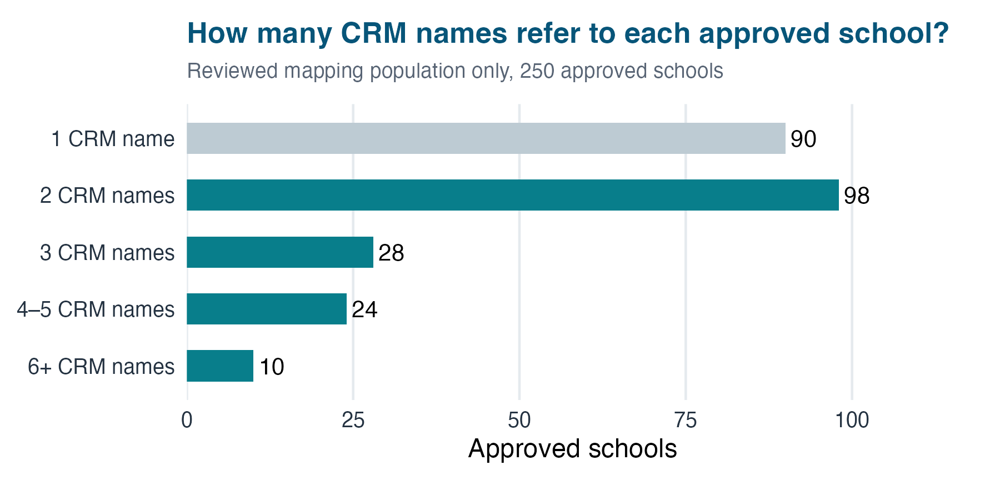
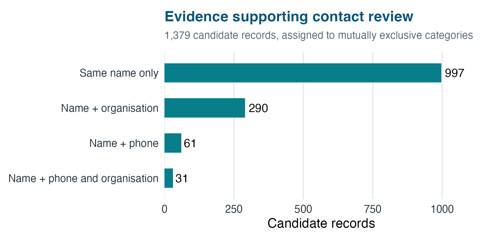
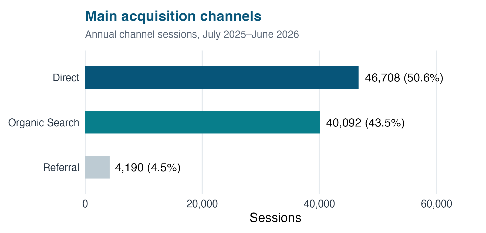
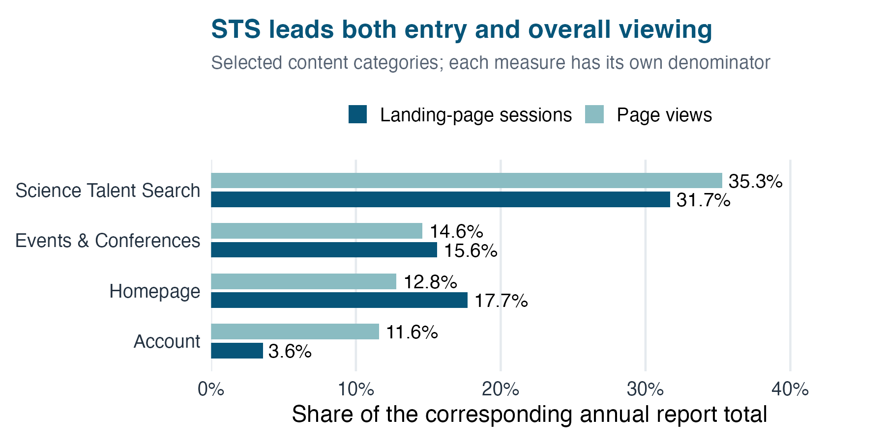
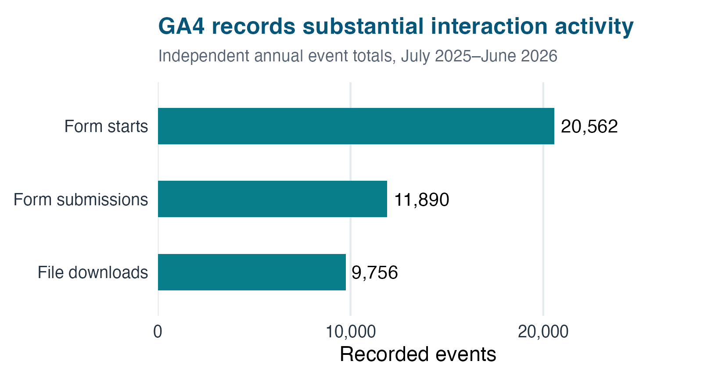

## Understanding STAV’s contacts and website use

CRM data quality and website analytics

Feng Zhu ETC5543 · Semester 2, 2026

How can STAV use its existing data to support better decisions?

::: {.notes}
Good morning. Today I will present my analysis of STAV’s contact and website data, and the Shiny dashboard I built to explore the findings.

中文提示：开场：先说业务目标，再介绍两个数据源。
:::

## Business questions and data

::: {.columns}
::: {.column width="48%"}
### CRM
Who is recorded, and how reliable are school and membership information?

**6,051 records**  
Snapshot: 29 July 2026
:::
::: {.column width="48%"}
### GA4
How do visitors reach and use the website?

**55,599 Active Users**  
1 July 2025–30 June 2026
:::
:::

::: {.takeaway}
The analyses provide complementary views. They do not link individual website users to CRM contacts.
:::

::: {.notes}
This project uses two separate sources. The CRM snapshot contains about six thousand contact records. The website data covers July twenty twenty-five to June twenty twenty-six, with about fifty-six thousand Active Users. The CRM helps us examine contact and membership information. GA4 helps us understand website use. These are different populations, and I did not link individual website users to CRM contacts.

中文提示：说明时间、分析单位和没有进行个人层面关联。

Sources: reports/CRM/02_crm_analysis_report.qmd; reports/GA4/stav_website_report.qmd; R/crm_organisation_master_mapping.R.
:::

## CRM and website analysis workflow

DATAPREPARATIONANALYSISOUTPUTS

<b>CRM snapshot</b><small>Contact records</small>

<b>Validate imports</b><small>Standardise fields</small>

<b>Review records</b><small>Contacts &amp; membership</small>

<b>Review priorities</b><small>Records needing checks</small>

School names<b>Fuzzy candidates</b><i>→</i><b>Catie’s review</b><i>→</i><b>Approved mapping</b>

<b>GA4 exports</b><small>Website activity</small>

<b>Group pages</b><small>Business categories</small>

<b>Compare usage</b><small>Check tracking gaps</small>

<b>Website priorities</b><small>Content &amp; measurement</small>

Both streams inform recommendations for STAV

R and Quarto document the reporting process. The streams remain separate.

::: {.notes}
I organised the work into two streams. For the CRM, I validated the import, standardised fields and reviewed contact and membership information. For school names, fuzzy matching generated possible matches, which Catie reviewed before they entered the approved mapping. For GA4, I grouped pages into business categories and compared traffic, content use and tracking gaps. The two streams lead to recommendations for STAV.

中文提示：突出 fuzzy matching 是候选生成，人工审核才确认；不要声称具体算法或阈值。

Sources: reports/CRM/02_crm_analysis_report.qmd; reports/GA4/stav_website_report.qmd; R/crm_organisation_master_mapping.R.
:::

## Fuzzy matching supports school name standardisation {.crm-section .school-example-slide}

{.evidence-plot}

<strong>544</strong>distinct CRM school names

<strong>250</strong>approved schools reviewed

<strong>64%</strong>have multiple names (160/250)

<b>Example: Caulfield Grammar School</b> “Caulfield Grammar” + “Caulfield Grammar Malvern Campus” → approved school: <b>Caulfield Grammar School</b><small>9 CRM name variations in the reviewed mapping; campus information remains separate.</small>

CRM report §4.1. Nine ambiguous names need review. Mapping has not changed the underlying CRM records.

::: {.notes}
The reviewed mapping contains over five hundred school-name variations for two hundred and fifty approved schools. Almost two-thirds of those schools have more than one name. Rather than reading every bar, I will use the example below. Caulfield Grammar School has nine name variations, including the shorter name Caulfield Grammar and a name referring to its Malvern campus. The mapping links these to an approved school while keeping campus information separate. This supports future standardisation. It does not mean that the underlying CRM records have already been merged.

中文提示：强调64%的分母是已审核250所学校；mapping ≠ 已经改好CRM。

Sources: reports/CRM/02_crm_analysis_report.qmd; reports/GA4/stav_website_report.qmd; R/crm_organisation_master_mapping.R.
:::

## CRM review priorities {.crm-section}

{.evidence-plot}

<strong>1,379</strong>same-name candidate records (22.8% of 6,051)

<strong>189 / 630</strong>school-plan records lack organisation (30.0%)

<strong>49 / 632</strong>Active records have an earlier end date (7.8%)

CRM report §§2.2, 4.4, 5.1–5.3. 566 same-name groups. Derived percentages use the displayed record denominators. These are review indicators, not confirmed errors.

::: {.notes}
The CRM checks highlight three review priorities. First, about fourteen hundred records share a name with another record. Most candidates share only a name, so they are not confirmed duplicates. Second, thirty percent of school-plan records have no organisation recorded. Third, about fifty records are marked Active despite an end date before the snapshot. These findings help STAV prioritise checks. They do not prove that a contact is duplicated or a membership is invalid.

中文提示：联系人同名检查与学校fuzzy matching分开；49条不能直接叫过期会员。

Sources: reports/CRM/02_crm_analysis_report.qmd; reports/GA4/stav_website_report.qmd; R/crm_organisation_master_mapping.R.
:::

## CRM review examples {.crm-section}

ILLUSTRATIVE RECORD PATTERNWHY REVIEW?NEXT CHECK

<b>Same name + same school</b><small>Different email addresses</small>

One person or two colleagues?

Confirm identity before merging

<b>School group plan</b><small>Organisation field is blank</small>

School link is unclear

Confirm the school and group role

<b>Status = Active</b><small>End date precedes 29 July 2026</small>

Status and date need reconciliation

Check entitlement and renewal rules

Illustrations of the report’s review categories, not individual CRM records. A review flag does not establish an error.

::: {.notes}
These examples show what a review flag means. Two records with the same name and school but different emails could represent one person or two colleagues. A school-plan record with a blank organisation needs its school link confirmed. An Active record with an earlier end date needs checking against renewal and entitlement rules. Each case needs review before changing the CRM.

中文提示：三个例子是报告类别的示意，不是真实联系人明细。重点说下一步怎么核查。
:::

## Website traffic terminology {.ga4-section}

<b>Direct</b>No other referring source identified<small>May include typed URLs, bookmarks or missing attribution</small>

<b>Organic Search</b>Visits from unpaid search results<small>For example, Google or Bing search</small>

<b>Referral</b>Visits via links on other websites<small>A referring website sends the visitor to STAV</small>

<b>Session / engagement rate</b>A visit period / share of engaged sessions<small>Engaged: over 10 seconds, a Key Event, or at least two page or screen views, as described in the report</small>

Terminology as explained in the GA4 report. Sessions include repeat visits; engagement criteria do not establish organisational outcomes.

::: {.notes}
Before the traffic results, here are the main terms. Direct means GA4 did not identify another referring source. It can include bookmarks or missing attribution. Organic Search means unpaid search results, such as Google or Bing. Referral means a link from another website. A session is a period of website interaction, so one person can generate several sessions. Engagement rate describes the share of sessions meeting GA4’s engagement criteria. It is not a membership conversion rate.

中文提示：先解释术语再讲图。Direct不只是输入网址；session不是人数；参与率不是转化率。
:::

## Search generates substantial website traffic {.ga4-section}

{.evidence-plot}

<strong>≈94%</strong>of channel sessions: Direct + Search

<strong>59.3%</strong>Organic Search engagement rate

<strong>29.2%</strong>Direct engagement rate

GA4 report, Acquisition Channels. Main channels shown; others omitted. Engagement uses GA4 session criteria and does not establish business value.

::: {.notes}
About half of channel sessions came through Direct, and around forty-four percent came through Organic Search. Together, they contributed roughly ninety-four percent. Referral was much smaller, at around five percent. Search sessions also had a higher engagement rate: about sixty percent, compared with about thirty percent for Direct. The practical message is to protect important search entry pages when changing URLs. Higher engagement alone does not establish greater business value.

中文提示：Direct不只是手动输入网址；参与率不等于商业价值。

Sources: reports/CRM/02_crm_analysis_report.qmd; reports/GA4/stav_website_report.qmd; R/crm_organisation_master_mapping.R.
:::

## Science Talent Search leads content use {.ga4-section}

{.evidence-plot}

<strong>68,467</strong>STS views out of 193,799 overall

<strong>10,082</strong>STS views in peak month, May 2026

<strong>1,114</strong>STS views in lowest month, Sep 2025

GA4 report, Website Content and Monthly Content Trends. Two measures use separate denominators. Selected categories do not total 100%.

::: {.notes}
Science Talent Search, or STS, was the leading content category. It accounted for about one-third of entry sessions and just over one-third of page views. That is roughly sixty-eight thousand views across the year. Entry sessions describe where visits begin, while page views include repeated viewing throughout a visit. STS viewing also varied substantially: around ten thousand views in the peak month, compared with just over one thousand in the quietest month. This supports prioritising STS content maintenance. The data alone does not explain the cause of the monthly changes.

中文提示：解释入口与浏览量不同；不要把浏览量解读为完成任务。

Sources: reports/CRM/02_crm_analysis_report.qmd; reports/GA4/stav_website_report.qmd; R/crm_organisation_master_mapping.R.
:::

## Tracking gaps limit outcome measurement {.ga4-section}

::: {.columns}
::: {.column width="64%"}
{.tracking-plot}
:::
::: {.column width="34%"}
### What remains unknown?
Which form or file?

Which starts led to submissions?

Which actions represent business outcomes?
:::
:::

::: {.takeaway}
Audit tagging, add event detail and define Key Events. These counts do not form a conversion funnel.
:::

::: {.source}
Source: GA4 report, User Behaviour and Measurement and Data Limitations. Recent interaction events were not marked as Key Events at the reported inspection.
:::

::: {.notes}
GA4 recorded around twenty-one thousand form starts, twelve thousand form submissions and ten thousand downloads. But those totals do not tell us which forms or resources generated the activity. We also cannot divide starts and submissions to calculate a completion rate, because the records do not establish the same form journey. At the reported inspection, recent interaction events were not marked as Key Events. Missing events, missing detail and Key Event settings are different issues. STAV needs to audit important actions before measuring outcomes reliably.

中文提示：关键页：没记录、缺参数、没设Key Event是三个问题；具体完全缺失的行为需要现场验证。

Sources: reports/CRM/02_crm_analysis_report.qmd; reports/GA4/stav_website_report.qmd; R/crm_organisation_master_mapping.R.
:::

## Shiny app: what I built {.app-section}

MY IMPLEMENTATIONCONCRETE DESIGNWHY IT MATTERS

<b>Input validation</b><small>CRM summaries + GA4 exports</small>

Check columns, export dates and duplicate monthly rows

Catch incompatible inputs before displaying results

<b>Reactive exploration</b><small>Separate CRM and GA4 views</small>

Month, channel &amp; content filters Linked charts and summaries

Answer focused questions without editing R code

<b>Monthly comparisons</b><small>Previous calendar month</small>

Sessions / views: % change Engagement: percentage points

Missing month ≠ zero Zero baseline: unavailable

<b>Export &amp; configuration</b><small>Filtered CSV + fictional demo mode</small>

Download selected results Separate config from interface

Support follow-up analysis and repeatable demonstrations

<b>Calculation:</b> selected engagement rate = total engaged sessions ÷ total sessions (rather than an average of row percentages)

Local prototype using prepared snapshots; CRM summaries require external preparation. Sources: app.R, R/data.R, R/comparison.R, README. This slide describes implemented design, not measured organisational impact.

::: {.notes}
I built the Shiny app to make the prepared findings easier to explore. I added input checks for required fields, export dates and duplicate monthly rows. I also implemented filters that update the charts and summaries. Here, I can select a channel and compare it with the previous calendar month. Missing data stays unavailable rather than becoming zero. For engagement, changes use percentage points. Users can also explore content categories and download filtered results. Separate configuration and fictional demo data make the app easier to maintain and demonstrate. It remains a local prototype using prepared data.

中文提示：按“我实现了什么→为什么这样设计”来讲，不要只读页面功能。约60秒内，演示Traffic筛选和月度对比，再切Content说明导出；输入验证和配置用一句话带过。图中公式是实现逻辑示例，不是新的分析结果。

Source: apps/stav-dashboard/app.R; apps/stav-dashboard/R/data.R; apps/stav-dashboard/R/comparison.R; apps/stav-dashboard/README.md.
:::

## Recommendations for STAV

EVIDENCENEXT ACTIONINTENDED BENEFIT

<strong>64%</strong><small>of reviewed schools have name variations</small>

<b>Standardise CRM</b><small>Review names and records Agree membership rules</small>

<b>More reliable school &amp; member reporting</b>

<strong>35.3%</strong><small>of page views go to STS</small>

<b>Maintain priority pages</b><small>Update STS content Protect search entry points</small>

<b>Support access to frequently used content</b>

<strong>9,756</strong><small>download events with limited resource detail</small>

<b>Improve measurement</b><small>Audit tags and parameters Define Key Events &amp; CRM interactions</small>

<b>A basis for future outcome reporting</b>

Proposed actions and intended benefits. Implementation and impact have not been evaluated.

::: {.notes}
The recommendations follow the evidence. For CRM, standardise reviewed school names and check priority records using agreed membership rules. For the website, prioritise STS maintenance and protect important search entry points. For measurement, audit tags, add useful event details and define meaningful Key Events. Dated CRM interactions would also support future engagement reporting. The dashboard supports exploration, while these data improvements remain future work.

中文提示：讲建议如何对应证据，别声称已经实施或带来改善。

Sources: reports/CRM/02_crm_analysis_report.qmd; reports/GA4/stav_website_report.qmd; R/crm_organisation_master_mapping.R.
:::

## Conclusions

CRM
<strong>Reviewed school mapping</strong><small>Targeted contact and membership checks</small>

GA4
<strong>Clear website priorities</strong><small>Search access and Science Talent Search</small>

<strong>Next: stronger outcome measurement</strong><small>Event detail on the website and dated interactions in the CRM</small>

Thank you. Questions?

::: {.notes}
To conclude, the project provides a reviewed school mapping, targeted CRM checks and evidence for website priorities. The Shiny app makes those findings easier to explore. Better tracking and interaction history would support stronger outcome measurement. Thank you. I welcome your questions.

中文提示：总结贡献与实际价值，停下来进入问答。

Sources: reports/CRM/02_crm_analysis_report.qmd; reports/GA4/stav_website_report.qmd; R/crm_organisation_master_mapping.R.
:::

## Appendix: matching and membership {.appendix}

- Fuzzy matching generates school-name candidates. Human review establishes approved mappings.
- School-name mapping and same-name contact checks address different problems.
- Phone and organisation agreement support identity review, without confirming identity.
- Current membership needs agreed entitlement rules and an authoritative maintenance process.
- An Active status alone does not establish engagement.

::: {.notes}
Use only if asked. The available documentation does not verify a particular fuzzy distance metric, matching threshold or precision score. Do not invent these details.
:::

## Appendix: measurement boundaries {.appendix}

- GA4 users overlap across pages and devices. Avoid summing row-level users.
- New and returning user counts overlap.
- Recent path exploration covers August–September 2026, separately from the annual analysis.
- The current CRM export lacks sufficient dated interaction history for dormancy analysis.
- No individual CRM-to-GA4 linkage or causal impact evaluation forms part of this analysis.

## Appendix: analysis sources {.appendix}

- CRM: `reports/CRM/02_crm_analysis_report.qmd`
- GA4: `reports/GA4/stav_website_report.qmd`
- School mapping: `R/crm_organisation_master_mapping.R`
- Mapping process: Catie’s independent manual review of fuzzy candidate pairs

All reported findings describe the analysed snapshots. Live system settings and records may change.

## Appendix: Q&A discussion approach {.appendix}

1. **Clarify:** “Do you mean the matching method or the reviewed mapping?”
2. **Pause:** “Let me think about that for a moment.”
3. **Discuss uncertainty:** “We did not address that in this analysis. How would you suggest approaching it?”
4. **Learn:** “That is useful feedback. I will consider it in the next stage.”

Adapted from the lecturer’s Q&A tips supplied by the presenter. Use the questions as a discussion, including where scope or evidence is limited.

